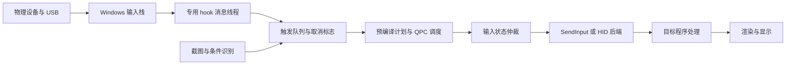

# 宏软件调度架构、Windows 输入延迟与 MacroHID 优化实施研究

调研日期：2026-10-14（Asia/Shanghai）。对象：当前 MacroHID 工作区、Windows 桌面宏及相关开源输入项目。

**结论：优先保留现有预编译、QPC 绝对时间轴、共享原生执行器，补齐分段测量，再优化热键入口、无效唤醒、条件检测和输入状态仲裁。Windows 上可以争取微秒量级的软件调度误差，但普通 Windows、SendInput、虚拟 HID 或 USB 宏键盘都不能保证任意负载下的微秒级端到端响应。** 如果“所有事件的最坏响应都小于若干微秒”是硬要求，需要把确定性输出放到有时限分析的 MCU/FPGA/实时控制系统；Windows 目标应用的处理和显示仍须单独验收。

本文交付调研与实施指南，本次未修改运行时代码、安装驱动、改变系统设置或运行真实输入注入。历史 CSV 已重新统计并核对哈希；没有把历史构建和测试结果当作当前版本的新测试。

## 1. 调研方法与证据边界

检索路径分四组：①项目官方源码与文档；②Microsoft Learn 的 Win32、驱动及 USB 文档；③ACM/IEEE 论文、USENIX 会议论文、作者/大学公开版本；④当前工作区源码及原始性能记录。检索关键词覆盖 macro scheduling、hook event dispatch、input queue、EDF、CBS、priority inversion、microsecond tail latency、USB input latency、Windows high-resolution timers。补充检索了较新的 kernel bypass 研究，纳入 NSDI 2024 Junction。

这是面向工程决策的定向文献综述，不声称穷尽市场、完成市场占有率调查或按 PRISMA 做元分析。“主流”指具有代表性的产品类别；“高星”按本次 GitHub API 快照筛选，**星数不代表速度或可靠性**。

证据分级：

| 标记 | 含义 | 使用边界 |
|---|---|---|
| 源码事实 | 本次读取到具体实现 | 限于所读版本、后端、路径；不是整个产品保证 |
| 官方行为 | 厂商/API 文档明确描述 | 不据此猜测内部堆、时间轮、线程池 |
| 论文结果 | 原文实验或理论 | 保留平台、模型和假设，不能直接外推 Windows 宏 |
| 历史测量复核 | 本次重算既有原始 CSV | 数据来自此前运行，不代表当前二进制重新测量 |
| 工程建议/目标 | 基于上述资料提出的设计 | 必须通过 A/B 和真实接收端验证 |

GitHub 元数据、源码下载清单和 SHA-256、历史数据复核输出见本目录 `evidence-2026-10-14`。部分源文件取自移动分支，哈希记录了实际读取内容；AHK 代码固定在 v2.0.19，未把仓库默认 alpha 当稳定版本。下载失败条目也保留在清单中，不作为依据。按键精灵搜索命中的 `help.anjian.com` 是含触摸/Android API 的文档，**不能证明 Windows 版线程实现**，因此该项标注未知。

## 2. 市场产品：队列、分发与并发

| 产品/类别 | 可核实的任务及事件模型 | 并发与队列结论 | 对 MacroHID 的价值 |
|---|---|---|---|
| AutoHotkey v2 | 热键/定时器/GUI 事件进入消息处理；脚本执行流可被事件打断并恢复 | 脚本“线程”主要是嵌套执行流，不等于每个宏一个 OS 线程；Critical 与线程限制控制可中断性。内部仍有钩子等辅助 OS 线程 | 参考短回调、消息分离、每热键重入策略，不把脚本伪线程当硬实时 |
| Pulover’s Macro Creator | 录制、可视化编辑并生成/运行 AutoHotkey 脚本 | 依赖其 AHK 运行时语义；不能视为独立的高精度 EDF 引擎 | 参考编辑器与执行计划分离 |
| AutoIt | AdlibRegister 周期调用函数，执行期间主脚本暂停 | 官方行为体现脚本回调串行/中断式处理；未公开证明存在微秒 deadline 队列 | 参考定时回调必须短小；避免识别阻塞控制流 |
| Jitbit Macro Recorder | 按命令播放，Delay 使用毫秒间隔 | 私有内部队列、锁及线程策略未知；播放速度控制不等于精确时限保证 | 用作功能/成功率对照，不能只比“无延时”吞吐 |
| Bartels Media Macro Recorder | 录制时间轴、播放速度、等待像素/图像/文本等条件 | 文档说明行为，未披露底层队列及并行算法 | 条件等待可比固定长 Sleep 更有效；测条件新鲜度 |
| Logitech G HUB | 配置宏类型，并区分软件与板载模式；部分宏在板载模式不可用 | 主机和固件是不同执行路径；不能把所有宏都称为硬件执行 | 对比时记录设备、固件、宏类型和是否依赖后台服务 |
| Razer Synapse 4 | 录制按键/鼠标及延时，宏分配给支持设备 | 内部调度与最坏延迟未公开；不能从“游戏外设”推定驱动级零延迟 | 作为产品行为对照，不能作为算法证据 |
| Quicker | 组合动作提供并行分支，支持向剩余分支发协作式取消 | 文档可确认控制流语义；底层线程数量、计时算法未知 | 借鉴取消作用域、分支完成策略，避免 Stop 后遗留动作 |
| 按键精灵 Windows | 本轮未获得足够匹配 Windows 版本的官方调度实现证据 | 队列结构、抢占方式、真实线程映射均未知 | 列入后续黑盒对照；不采用手机文档解释 Windows 实现 |

来源：[AHK 线程官方文档源码](https://github.com/AutoHotkey/AutoHotkeyDocs/blob/v2/docs/misc/Threads.htm)、[AHK 消息处理 v2.0.19](https://github.com/AutoHotkey/AutoHotkey/blob/v2.0.19/source/application.cpp)、[Pulover 项目说明](https://www.macrocreator.com/project/)、[AutoIt AdlibRegister](https://www.autoitscript.com/autoit3/docs/functions/AdlibRegister.htm)、[Jitbit 命令](https://www.jitbit.com/macro-recorder/macro-commands/)、[Macro Recorder 播放](https://www.macrorecorder.com/doc/playback/)、[条件等待](https://www.macrorecorder.com/doc/wait/)、[G HUB 板载限制](https://support.logi.com/hc/en-001/articles/22102343233943-Some-macros-do-not-work-when-in-Onboard-Memory-mode)、[Razer 宏配置](https://mysupport.razer.com/app/answers/detail/a_id/2003)、[Quicker 并行语义](https://docs.getquicker.net/v2/what%27s-new/actions/xaction-steps/)。

**比较原则：**闭源产品只能比较可观察的输入成功率、录制/播放时间偏差、并发行为和资源开销。没有公开源码、符号或可复核跟踪，就不能给它贴上“时间轮”“无锁队列”“内核 EDF”等算法标签。

## 3. GitHub 代表项目及源码启示

以下精确星数来自本次 API 查询，时间戳见 `github-repositories.json`。最后 push 时间不是最后发行日期或安全维护承诺。

| 项目 | Stars | 队列/分发/并发 | 适用性判断 |
|---|---:|---|---|
| [QMK](https://github.com/qmk/qmk_firmware) | 20,757 | 固件循环与输入状态机；deferred executor 使用固定容量表、毫秒触发时刻，按旧触发时刻推进周期 | 固件状态管理范例；现有 deferred API 本身并非微秒调度器 |
| [AutoHotkey](https://github.com/AutoHotkey/AutoHotkey) | 13,287 | 钩子向主消息处理投递热键，脚本执行受消息泵、可中断状态及重入限制控制 | 最相关的完整宏脚本参考；不要照搬 v1 SetBatchLines 到 v2 |
| [PyAutoGUI](https://github.com/asweigart/pyautogui) | 12,732 | 同步动作调用；所读源码默认 PAUSE=0.1 秒，鼠标还有最短时长/步进设置；Windows 路径仍使用 keybd_event/mouse_event | 易用自动化框架；默认延时会主导结果，不能用于证明 OS 注入慢 |
| [Kanata](https://github.com/jtroo/kanata) | 8,002 | 输入通道与单独处理逻辑、按键状态机、毫秒 tick；Windows 有低级 hook 和 Interception 路径 | 优先参考事件通道、tap/hold 与状态语义；不把 tick_ms 推断成微秒保证 |
| [KMonad](https://github.com/kmonad/kmonad) | 5,071 | 事件源→Dispatch→Hooks→Sluice→Keymap；STM 状态/重放缓冲；独立 emitter 从 TMVar 取输出 | 适合参考可组合事件处理和回放；TMVar 交接与 Haskell runtime 不提供硬时限 |
| [keyboard](https://github.com/boppreh/keyboard) | 3,972 | GenericListener 中监听和处理两条线程；Queue FIFO，消费者依次执行 handler | 清晰的采集/处理解耦样例；无界积压与慢 handler 会影响尾延迟，阻断输入路径须另看 |
| [AutoKey](https://github.com/autokey/autokey) | 3,896 | Linux 桌面自动化/脚本项目，本轮未深入其队列源码 | 跨平台功能参考，不作 Windows 输入架构证据 |
| [nut.js](https://github.com/nut-tree/nut.js) | 2,857 | async/await 编排与输入 provider；所读分支键盘 autoDelayMs=300 | provider 可插拔值得借鉴；Promise 并发不代表硬件同时输入 |
| [pynput](https://github.com/moses-palmer/pynput) | 2,173 | Listener 线程；Windows 上回调可能直接处于 OS 回调线程；官方建议把工作投到队列 | 采集层参考，不能在回调里跑识别、IO 或长计算 |
| [Pulover Macro Creator](https://github.com/Pulover/PuloversMacroCreator) | 2,026 | AHK 生态的可视化录制/编排 | 适合参考宏表达和导出；本次快照最后 push 为 2022 年 |
| [Interception](https://github.com/oblitum/Interception) | 2,019 | 键鼠过滤驱动及用户态等待、接收、发送接口 | 适合研究设备路径；不是调度算法，也没有证明比 SendInput 更快；快照最后 push 为 2021 年 |

具体源码入口：[AHK hook.cpp](https://github.com/AutoHotkey/AutoHotkey/blob/v2.0.19/source/hook.cpp)、[keyboard GenericListener](https://github.com/boppreh/keyboard/blob/master/keyboard/_generic.py)、[PyAutoGUI 配置](https://github.com/asweigart/pyautogui/blob/master/pyautogui/__init__.py)、[Windows 后端](https://github.com/asweigart/pyautogui/blob/master/pyautogui/_pyautogui_win.py)、[Kanata 低级 hook](https://github.com/jtroo/kanata/blob/c391826f6bbc8d5dc1645bbedc5596e22ae5982a/src/kanata/windows/llhook.rs)、[Kanata 调度状态](https://github.com/jtroo/kanata/blob/main/src/kanata/mod.rs)、[KMonad 入口](https://github.com/kmonad/kmonad/blob/master/src/KMonad/App/Main.hs)、[KMonad Dispatch](https://github.com/kmonad/kmonad/blob/master/src/KMonad/Model/Dispatch.hs)、[pynput 回调约束](https://github.com/moses-palmer/pynput/blob/master/docs/keyboard-usage.rst)、[nut.js 键盘编排](https://github.com/nut-tree/nut.js/blob/e413fa1f19a19c4631812e4e1eaf47aa732b5cbe/core/nut.js/lib/keyboard.class.ts)、[QMK deferred executor](https://github.com/qmk/qmk_firmware/blob/master/quantum/deferred_exec.c)。

这些项目的共同价值是**事件所有权、输入状态机、采集和执行解耦**。本轮没有发现可以直接移植后就承诺 Windows 微秒级端到端响应的通用宏引擎。Python/JavaScript 并非不能做宏，而是其默认动作节流、运行时停顿和事件循环应与精密时序执行层分开。源码借鉴与复制实现不同，若直接引入代码，另核对实际文件许可证；API 的 null/NOASSERTION 不表示无许可约束。

## 4. Windows 调度与输入链路

### 4.1 先定义测量对象

设 t0 为物理按键闭合，t1 为本程序 hook 回调入口，t2 为任务入队，t3 为执行器开始，d 为该批次目标 QPC 时刻，t4/t5 为 SendInput 进入/返回，t6 为受控接收程序处理事件，t7 为关联画面实际发光。

| 指标 | 定义 | 能证明什么 |
|---|---|---|
| 调度有符号误差 | t4 − d | 是否早发/迟发；必须保留符号 |
| 调度迟到 | max(0, t4 − d) | deadline 服务水平，不代表端到端 |
| 热键软件启动 | t4 − t1 | 本程序从收到 hook 到首次提交 |
| API 调用时长 | t5 − t4 | 调用开销及其间可能发生的阻塞/抢占 |
| 软件输入处理 | t6 − t4 | 注入开始到接收处理，需关联同一事件 |
| 物理到接收 | t6 − t0 | 包含键盘固件、USB 和主机输入路径 |
| 动作到发光 | t7 − t0 | 用户体验链路，需要光学/硬件证据 |

**不要默认 t6 ≥ t5。** 接收方可能在 SendInput 返回前已经运行。用 t6−t5 作为唯一“系统排队时间”可能出现负数；应关联 t4、t5、t6 并保留并发关系。各段 P99 也不能相加后称为端到端 P99。



这是测量/职责示意，不表示所有输入 API 都走完全相同的内核路径。

### 4.2 优先级、时钟和定时器

Windows 使用基于线程优先级的抢占调度；计时器到期只使等待可被满足，线程仍须获得 CPU。提升线程优先级不能压过硬件中断、某些 DPC 工作或固件停顿。CPU 迁移、缺页、锁竞争、频率/电源状态和同核竞争都是要测的变量。`REALTIME_PRIORITY_CLASS` 甚至会妨碍输入相关系统线程，不宜作为宏软件默认设置。[Windows 调度优先级](https://learn.microsoft.com/en-us/windows/win32/procthread/scheduling-priorities)、[硬件 IRQL](https://learn.microsoft.com/en-us/windows-hardware/drivers/kernel/managing-hardware-priorities)。

QPC/Stopwatch 是测量和绝对时间轴的基准，不是唤醒机制。QPC 频率是接口刻度，不等于 CPU 主频；不要用未经验证的裸 RDTSC 替换它。相对定时器参数的 100ns 单位也不代表 100ns 实际精度。[QPC 官方指南](https://learn.microsoft.com/en-us/windows/win32/sysinfo/acquiring-high-resolution-time-stamps)。

高分辨率 waitable timer 自 Windows 10 1803 起可用。建议远期阻塞等待、临近 deadline 短自旋，每次恢复后重新读取 QPC。原点使用 QPC，转换为相对 timer 间隔；不要把 QPC tick 当作绝对 FILETIME。`timeBeginPeriod` 在 Windows 10 2004 后具有进程相关行为，Windows 11 对完全遮挡/最小化等场景还有约束；它不提高 QPC 精度，更不能视为硬实时开关。[CreateWaitableTimerExW](https://learn.microsoft.com/en-us/windows/win32/api/synchapi/nf-synchapi-createwaitabletimerexw)、[timeBeginPeriod](https://learn.microsoft.com/en-us/windows/win32/api/timeapi/nf-timeapi-timebeginperiod)。

MMCSS 可以改善时间敏感线程获得 CPU 的机会，但不是任意应用时限保证。本项目的 Pro Audio 配置应作为可回退实验档，比较目标应用帧时间、CPU 和功耗，不能以提高优先级次数作为成功指标。[MMCSS](https://learn.microsoft.com/en-us/windows/win32/procthread/multimedia-class-scheduler-service)。

### 4.3 SetWindowsHookEx 的瓶颈与优化

`WH_KEYBOARD_LL/WH_MOUSE_LL` 属于监听/拦截入口。低级键盘 hook 在安装线程上下文执行，必须持续泵消息；它不是“回调在目标进程运行”的普通 DLL hook。超时可能导致静默移除。Windows 11 已不支持传统 journaling hooks，不能用旧宏录制教程的 WH_JOURNALPLAYBACK 作为新架构。[LowLevelKeyboardProc](https://learn.microsoft.com/en-us/windows/win32/winmsg/lowlevelkeyboardproc)、[SetWindowsHookExW](https://learn.microsoft.com/en-us/windows/win32/api/winuser/nf-winuser-setwindowshookexw)。

工程建议：

1. 回调只做时间戳、注入标记过滤、必要键状态更新、查预建路由和有界投递；过滤/吞键决定必须在返回前完成，不能全部延后。
2. 不在回调做进程名解析、图像识别、同步 UI 调用、等待工作线程或文件 IO。保持 delegate 有效并正确卸载。
3. 若仅需标准组合热键，可独立比较 RegisterHotKey；录制/设备区分可比较 Raw Input；需要同步吞键时仍保留 LL hook。
4. Raw Input 是另一种异步观测入口，不是 SendInput 的替代注入方法；不能假定它一定给出与 LL hook 完全相同的合成输入事件。
5. 自身注入的过滤策略应显式定义：忽略所有 injected 事件简单，但会排除其他软件/辅助设备的合成输入。仅识别自身标记时也不能把标记当安全身份。

Raw Input 能提供设备相关信息并支持后台接收配置，但不意味着目标应用就会更快消费输入。[Raw Input 概览](https://learn.microsoft.com/en-us/windows/win32/inputdev/about-raw-input)。

### 4.4 SendInput 的瓶颈与优化

SendInput 成功返回的是写入输入流的事件数，受完整性级别限制；UIPI 导致的失败不会由返回值/错误码明确指出。单次输入数组保持内部序列不被其他键鼠输入插入，但不提供执行时刻参数，也不保证应用已处理。[SendInput](https://learn.microsoft.com/en-us/windows/win32/api/winuser/nf-winuser-sendinput)。

优化应围绕自身可控成本：

- 提前编码、复用 INPUT 缓冲；把同一时刻且语义可合并的事件做一次调用，减少调用次数。
- 不把不同 deadline 的事件提前塞进一个数组；`INPUT.time` 也不是未来调度功能。批处理收益必须同时检查按住时长和目标程序识别率。
- 键码/扫描码/Unicode 依语义选择；扫描码不是通用加速开关。鼠标相对/绝对移动、DPI、加速和移动合并需要独立验证。
- 不持调度锁调用 API；否则输入回调、取消和其他宏可能被串行拖住。也不要让自己 hook 等待正在调用 SendInput 的线程。
- 单次批次内部有序不代表多线程调用的跨宏顺序确定。需要显式的全局序号或冲突键仲裁。
- 检查部分成功。不能盲目重放整批，否则可能重复按下；按已成功部分更新状态，停止/清理要有独立路径。
- 不使用未公开 syscall 号绕过接口来赌性能；系统版本兼容性代价并没有消除目标程序排队。

### 4.5 驱动级输入与“硬件中断模拟”

| 路径 | 可解决什么 | 新增代价与无法解决的部分 | 推荐 |
|---|---|---|---|
| SendInput | 标准桌面键鼠合成 | 权限、输入状态、hook、目标消费节奏 | 默认基线 |
| VHF 虚拟 HID | 按 HID 报告建模的虚拟设备、设备语义 | 内核驱动开发/签名/生命周期、报告缓冲；目标线程仍受 Windows 调度 | 有设备语义需求再做独立原型 |
| Interception 类过滤驱动 | 观察/变换设备输入，选择设备路径 | 驱动及 IOCTL 跳转、设备兼容、部署；用户态策略仍会被抢占 | 作为兼容性研究分支，先测再选 |
| MCU/FPGA USB HID | 主机外生成时间序列，减少主机触发依赖 | 主机轮询、USB 总线与输入栈仍在；PC 实时下发还新增传输延迟 | 预装计划/本地触发适用 |
| 实时设备的定时 GPIO | 控制输出引脚的确定性边沿 | 不等价于 Windows 应用按键，也不是显示响应 | 真正硬时限的独立控制场景 |

VHF 官方支持由 HID source driver 提交报告；它并没有承诺键鼠响应的微秒上界。[VHF](https://learn.microsoft.com/en-us/windows-hardware/drivers/hid/virtual-hid-framework--vhf-)。

USB 的 interrupt transfer 名字不意味着外设随时中断应用执行；主机按端点服务间隔轮询。1000Hz 的周期为 1ms，8000Hz 为 125µs；在随机相位、无其他排队的理想模型下仅轮询等待平均约半个周期。这是算术模型，不是某设备实测，也不能保证端到端小于该数值。[USB interrupt transfer](https://learn.microsoft.com/en-us/windows-hardware/drivers/usbcon/how-to-send-a-usb-interrupt-transfer--uwp-app-)。

因此，“驱动级注入更低层，所以必然更快”“模拟中断即可绕过调度”均不是成立的性能论证。推荐用同一接收端对不同后端做配对实验。硬件端若要微秒级边沿，应采用硬件计时器/比较输出并测时钟误差；QMK 默认毫秒 deferred API 不足以直接承担该指标。

## 5. 论文解读：可借鉴模型与不可迁移前提

| 论文与出处 | 核心模型/发现 | MacroHID 落地方法 | 适用限制 |
|---|---|---|---|
| Liu & Layland, 1973, JACM, *Scheduling Algorithms for Multiprogramming in a Hard-Real-Time Environment*, DOI 10.1145/321738.321743 | 固定优先级 RM 与动态 EDF 的可调度性 | 按绝对到期时刻挑下一个小批次，避免长宏占着执行权 | 独立、可抢占、执行成本已知等假设，Windows 宏并不满足 |
| Sha, Rajkumar & Lehoczky, 1990, IEEE TC, *Priority Inheritance Protocols: An Approach to Real-Time Synchronization*, DOI 10.1109/12.57058 | 优先级反转及继承/天花板协议 | 缩短共享锁，数据所有权化，避免高优先级依赖低优先级长工作 | 本轮查阅作者机构摘要；不把 Windows 普通 mutex 当作已实现论文协议 |
| Abeni & Buttazzo, 1998, RTSS, *Integrating Multimedia Applications in Hard Real-Time Systems* | CBS 用预算/周期隔离执行超支 | 对 OCR/模板识别设置并发数、补充周期、最大挂起任务 | 应用层限额是借鉴，不具备内核 CBS 的带宽保证 |
| Ousterhout et al., 2019, NSDI, *Shenango* | 高频资源调整、专门数据路径，结合忙轮询与资源效率 | 让控制、识别与精密提交分离；仅在临近 deadline 占核心 | 专用 IOKernel/网络数据中心平台，不能移植为普通 Windows 用户态抢占 |
| Kaffes et al., 2019, NSDI, *Shinjuku* | 短任务被长任务阻塞导致尾延迟；借助特殊系统/硬件实现约 5µs 级抢占周期 | 把输入批次保持很短，识别分池；支持超时和协作取消 | 5µs 是其系统抢占周期，不是 Windows SendInput 延迟 |
| Humphries et al., 2021, SOSP, *ghOSt*, DOI 10.1145/3477132.3483542 | 内核机制与用户态调度策略分离，消息/事务式调度接口 | 拆出计划、等待、选择、输入后端策略；使用带代数/序号的状态变更 | 依赖 Linux 内核机制，不是 Windows 现成 API |
| Wimmer, Schmid & Bockes, 2019, CHI, *On the Latency of USB-Connected Input Devices*, DOI 10.1145/3290605.3300650 | 36 个设备的延迟分布；提高轮询率并非对所有设备都有效 | 单独测设备、主机、目标；报告分布而不只均值 | 论文具体设备数字不能外推本机/当前外设 |
| Fried et al., 2024, NSDI, *Making Kernel Bypass Practical for the Cloud with Junction* | 在兼容性和资源密度约束下设计 kernel bypass | 审视“为了最低延迟永久占核”的成本；保持后端可替换和退回路径 | 网络/Linux 架构启示，不是 Windows HID 的旁路实现 |

原文/机构链接：[Liu–Layland 原文](https://bears.ece.ucsb.edu/class/ece253/papers/laylandliu77.pdf)、[优先级继承作者机构记录](https://experts.illinois.edu/en/publications/priority-inheritance-protocols-an-approach-to-real-time-synchroni/)、[CBS 原文](https://retis.santannapisa.it/~giorgio/paps/1998/rtss98-cbs.pdf)、[Shenango 原文](https://www.usenix.org/system/files/nsdi19-ousterhout.pdf)、[Shinjuku 原文](https://www.usenix.org/system/files/nsdi19-kaffes.pdf)、[ghOSt 作者公开原文](https://www.ofirweisse.com/sosp21-ghost.pdf)、[USB 延迟作者版本](https://epub.uni-regensburg.de/40182/1/On_the_Latency_of_USB-Connected_Input_Devices_author_version.pdf)、[Junction 会议页](https://www.usenix.org/conference/nsdi24/presentation/fried)。

在理想单核、独立周期任务、截止期等于周期、可抢占且无额外开销的模型中：

\[
U=\sum_i C_i/T_i,\quad U_{RM}\le n(2^{1/n}-1),\quad U_{EDF}\le1.
\]

RM 的上式是充分界而非所有任务集的必要界。现实应加入非抢占区、锁阻塞、唤醒抖动和外部干扰。当前宏调度更接近“下一到期事件选择”，批次的到期时刻通常同时是释放时刻；不能把它严格等同于论文里的可抢占 EDF 作业调度，也不能拿 U≤1 宣告达标。

工程上可用 `服务时间/到达间隔` 估计负荷并留余量，但 P99 成本不是 WCET，经验占用阈值不是硬实时证明。其实际价值是提前拒绝过载、隔离重工作、减少排队。

CBS 的可迁移部分是用预算 Q 和周期 P 表达服务份额 `u=Q/P`，耗尽预算时延期后续工作，而不是让识别无限抢占输入资源。应用层可以限制每轮准入的识别数、累计 CPU 时间和并发槽位，但普通 OCR 库的一次调用往往不可抢占：设置“2ms 预算”不会让一个 20ms 调用在 2ms 自动停止。须采用可分片识别、独立工作进程或超时后丢弃过期结果，并报告已启动工作的实际完成成本。

## 6. 当前项目：已存在的能力与剩余风险

本次检查工作区含大量既有未提交更改；以下描述对应读取时内容，不对应某个纯净发布标签。文件快照哈希见证据目录。

| 模块 | 本次确认现状 | 应做增量优化 |
|---|---|---|
| `GlobalKeyboardHook.cs` | 独立 Dispatcher 消息线程、回调 QPC、注入事件过滤；事件同步调用订阅者 | 缩减订阅者在回调栈上的工作，测回调驻留分布 |
| `MainWindow.xaml.cs` 热键处理 | UI 更新已 BeginInvoke；控制器启动直接调用；前台过滤会查询进程名，存在 triggerGate | 不应再提“先把全部热键搬离 UI”作为未实现项；优先测前台查询、锁与启动链 |
| `MacroPlaybackController.cs` | 锁保护启动/停止，runId/取消/任务生命周期管理 | 投递与完成路径的分配和排队开销；保持重复触发、Hold/Toggle、停止 epoch 语义 |
| `CompiledPlaybackPlan.cs` / executor | 批次预编译、prepared/native plan 缓存，条件计划准备 | 测热缓存命中和失效，不重复实现预编译 |
| `QpcPlaybackDelayStrategy` | 已把自旋校准放入 Prepare 和缓存，构造函数不再每次校准；高精度等待 | 不再把“每次启动校准”列作当前事实；测不同核心类别缓存和等待回退 |
| `SharedPlaybackScheduler.inl` | 两条复用工作线程；每宏只挑下一批；vector 扫描；等待及提交不持队列锁；inFlight 防同批重复认领 | 扫描成本、全局 generation/Notify、同键跨宏顺序、helper 获益 |
| 原生等待模式 | 均衡末段 300µs，极限 1000µs；helper 比 owner 延后约 2µs 参与认领 | 把固定自旋/helper 改为经测量选择的策略实验，而非增加更多线程 |
| `PlaybackWorkers.cs` / lease | 工作线程复用；空闲保留限额，ParallelWorkerLease 对特定并行工作设 32 上限 | 空闲上限不等于全系统活动线程上限；条件线程和同时宏需单独准入 |
| `ConditionMonitor.cs` | 条件独立线程、绝对轮询目标、跳过已错过轮询；then 计划缓存 | 线程总量、帧新鲜度、条件预算；不做积压轮询补跑 |
| `MacroModel.cs` | 两种条件步骤默认轮询间隔 25ms | 这是条件反应的主要量级因素；不能只优化输入末端 10µs |
| `PixelFrame.cs` / evaluation cache | 已有 BGRA 缓冲和短期复用，识别结果合并窗口默认约 1ms | 区分抓帧时间和计算完成时间，测缓存命中对应的帧年龄 |
| `AppLog.cs` | 已有有界后台日志队列 | 不能声称启动路径同步写磁盘；仍可测字符串/节点分配、队列锁 |
| `PlaybackTrace.cs` | 有 Hotkey、Dispatch、Submit、Receiver 等 stage | 缺少足够的逐批次身份/字段时补齐；声明 Receiver 枚举不等于已有接收端测量 |
| `LatencyProbe` | 明确不发送真实按键；空批次/假输入用于探针 | 它的结果不能表示真实 SendInput 或目标应用接收延迟 |

定位入口（仓库相对路径，便于复查）：

- `src/ui/MacroStudio/GlobalKeyboardHook.cs`：KeyboardHookCallback、TriggerPressed。
- `src/ui/MacroStudio/MainWindow.xaml.cs`：KeyboardHook_TriggerPressed。
- `src/ui/MacroStudio/Services/ForegroundProcessService.cs`：GetForegroundProcessName。
- `src/shared/MacroHid.Runtime/MacroPlaybackController.cs`：StartRunCore。
- `src/shared/MacroHid.Runtime/MacroPlaybackExecutor.cs`：QpcPlaybackDelayStrategy、Prepare、TryGetPreparedPlan。
- `src/native/MacroHid.NativePlayback/SharedPlaybackScheduler.inl`：Due、Loop、Notify、Submit。
- `src/shared/MacroHid.Runtime/ConditionMonitor.cs`：PollCore。
- `src/shared/MacroHid.Runtime/RecentEvaluationCache.cs`：Get。

### 历史原始数据的本次复核

两份 CSV 的 SHA-256 与既有 provenance 一致。原试验是两个并发计划、每计划 50,000 个 1ms 批次；假输入回调、预热、申请与播放会话一致的计时器设置。原环境记录为 Ryzen 9 7945HX、Windows 11 build 26200；本次没有重新验证机器状态或重跑。

| 档位/计划 | N | CSV 整数 µs P50 | P95 | P99 | 按原始 QPC 重算 P99.9 | 原始 QPC 最大迟到 |
|---|---:|---:|---:|---:|---:|---:|
| 均衡 0 | 50,000 | 0 | 0 | 1 | 185.6µs | 1093.9µs |
| 均衡 1 | 50,000 | 0 | 0 | 1 | 3.7µs | 876.2µs |
| 极限 0 | 50,000 | 0 | 0 | 0 | 2.1µs | 644.0µs |
| 极限 1 | 50,000 | 0 | 0 | 0 | 2.1µs | 1071.4µs |

采用 nearest-rank 分位数。表中 0 来自整数微秒列，**不是零延迟**。全部样本合并后均衡 P99.9 为 110.1µs，但合并会掩盖计划差异，因此不能只报告合并结果。以上每档仅一轮历史数据；没有真实注入、真实物理热键或跨设备验证。

原数据还需要注意统计口径：调度器记录相对 nominal due 的迟到，但 `Due()` 会加暂停、按键释放依赖及组合键保持约束。今后同时输出 nominal_due、effective_due，区分“语义要求推迟”和“调度器迟到”，避免误诊。

## 7. 可落地算法设计

### 7.1 任务队列分层

推荐在现有框架上形成三层职责，不预设必须重写为无锁：

1. **触发/控制入口**：固定结构 `(macroId, epoch, sourceQpc, sequence, action)`；hook 单生产者路径可用 SPSC，有 UI/条件多来源时用各自 SPSC 汇聚或真正 MPSC，不能把多生产者硬套 SPSC。容量以最大预期突发定义；满队列时明确拒绝并计数，停止信号走独立原子标志/唤醒。
2. **时间队列**：每个 active run 保存下一批，不展开全部循环事件；候选键为 `(effectiveDue, stableSequence)`。小 N 先保留连续数组扫描，大 N 经测量再切小根堆。暂停、取消、依赖变化必须更新堆或带 generation 做失效过滤，并限制陈旧节点数量。
3. **输入提交/仲裁**：决定同键和修饰键冲突后才提交；不可丢 key-up。输出日志/统计用有界缓冲，后台批量处理。

| 结构 | 成本 | 实际取舍 |
|---|---|---|
| 连续数组线性扫描 | 选取 O(N) | N 很小时局部性好、更新简单，当前实现可能已经更合适 |
| 二叉最小堆 | 入/出 O(log N) | 活跃宏较多时适用；处理暂停/取消/同刻顺序复杂 |
| 时间轮 | 平均摊销可很低，精度受桶宽/设计影响 | 大量粗粒度定时器适用；少数精密宏未必有收益 |
| FIFO 触发队列 | 常数级入出 | 只表示到达顺序，不自动满足 deadline 优先 |
| 每宏一条精密线程 | 易写局部逻辑 | 多线程自旋、切换、同键交错；不作为扩容方向 |

先比较 1/2/8/32 活跃宏；如产品确实支持更大规模，再比较 128/256。不要只用渐进复杂度推断 2 个宏时堆更快。

### 7.2 绝对时间轴与迟到策略

周期保持 `d(k)=t_origin+k*T`，不要在每次执行后重置为 `now+T`，否则开销累积成漂移。将目标时刻和动作允许语义分开：

\[
d_{effective}(k)=\max(d_{nominal}(k)+pause,
t_{dependency}+hold_{min}).
\]

赶不上时间时明确选择：短暂迟到的离散按键按序执行并维持必要 hold；过期鼠标轨迹可在声明允许时合并；识别任务只处理最新帧；过载严重时终止宏并释放持有键。**不能统一用“追赶补发”造成按下/抬起挤在一起，也不能统一丢弃过期按键。**

### 7.3 自适应阻塞＋自旋

令 W 为预留自旋窗口，e 为计时器实际恢复减去计划唤醒时刻的正向超时量，h 为唤醒后选取/认领的开销。工程实验模型：

\[
W=clip(Q_p(e+h)+margin, W_{min}, W_{max}).
\]

在后台统计最近窗口，缓慢调整，空闲/恢复/电源状态改变后重建样本；按档位、核心类别分别学习。p、margin 和上下限均为试验参数，不是定理。离群事件需要记录，不能用无限加大 W 来掩盖 DPC 或系统停顿。

```text
接收控制命令，检查取消/暂停/generation
取当前最早有效批次，计算 effective_due
若 remaining > W：设置相对高精度 timer，等待 timer 或更早任务/取消事件
否则：短自旋并检查变化；不早于 effective_due
再次校验计划与输入冲突，认领一次
锁外提交输入，记录 submit_begin/submit_end/返回数量
更新状态，只唤醒确实需要重新选任务的 worker
```

W=300µs、周期 1ms 时，单 worker 的末段自旋就可能接近一个逻辑核的 30%；W=1000µs 时可能接近持续占核。此处仅是忽略其他开销的上限量级估算，双 worker 是否同时自旋由实际负载决定，必须测 CPU time。更小调度误差若换来更差帧时间，产品价值可能下降。

### 7.4 控制双 worker 的收益与副作用

当前极限模式 helper 可在 owner 之后约 2µs 参与，`inFlight` 在锁内保护同批认领。保留这层正确性，不允许两条线程试发同一按键再择优。

实验比较：单提交线程；当前双 worker；延迟更大的 helper；只在有历史长尾风险时启用 helper。采集 helper win 比例、同批认领竞争、锁等待、唤醒次数、跨核心缓存流量及目标帧时间。每次提交后的全局 Notify 会使其他 worker 重新检查 generation；改成按 owner/更早 deadline 唤醒时，必须验证无丢失唤醒、暂停/取消及时生效以及新任务可以打断旧等待。

跨宏同键的状态不能由每宏独立字典模拟成独立物理设备。可选策略：冲突键串行租约、拒绝冲突宏、明确的共享按住引用计数。引用计数会改变脉冲/重复语义，不能静默替换。建议默认保守串行冲突，保留用户可见的冲突策略。紧急停止只释放本程序实际拥有的状态，并验证与物理按键同时按下的行为。

### 7.5 条件检测：优化更大的延迟项

默认 25ms 轮询，在事件相位均匀、计算足够快且未错过轮询的理想条件下，单轮询等待平均 12.5ms、P99 约 24.75ms。**这是模型推导，不是当前系统测量；识别和抓帧只会加入更多成本或改变分布。**

推荐：

- 像素/小 ROI、模板、OCR 分不同预算池；输入 deadline worker 不做识别。
- 暂停语义允许等待识别时，应把这种等待单独计入控制流耗时，不能从用户观察延迟中删除。取消不支持中断的识别调用时，先阻止其结果启动新输入，再异步回收资源。
- 每个检测源最多一个正在执行和一个最新待处理任务，防止旧帧排长队；不能对键盘动作应用这种覆盖规则。
- 记录 `frameCapturedQpc`、`evaluationBegin/End`、`cacheAge`，共享抓帧和识别结果时检验来源帧的新鲜度。
- 逐步实验像素轮询 25/10/5/2ms，模板/OCR 按实际服务时间设限，避免全量一律改 1ms。
- 提供受控事件源时优先事件驱动；屏幕识别仍受应用帧更新、捕获和识别速度限制。
- 图像已有 BGRA 优化和缓存，先测全链路，不重做已完成的每像素对象转换优化。

## 8. 分阶段实施指南与验收门槛

下列数字是拟议工程目标/决策门槛，不是已实现结果；具体机器不满足时报告失败并保留原始记录。

| 优先级 | 改动与位置 | 验证与目标 | 预期收益依据 |
|---|---|---|---|
| P0 | 扩展 PlaybackTrace、Native run trace；新增受控接收端与统一关联 ID | 每批具有 runId/batchId、nominal/effective due、submit_begin/end、接收时间/缺失原因；测量模式开关开销可量化 | 消除把 API 返回当接收、把 hold 约束当迟到等误判 |
| P0 | 热键路径分段计时；前台信息维护快照/必要复核；准备数据移出回调 | 建议 hook 自身工作 P99≤50µs；热启动按现有档位目标验收；禁止同步重 IO | 查询进程名和锁是源码确认的候选成本，收益待测 |
| P1 | SharedPlaybackScheduler 定向唤醒、减少无效 generation 变化 | 双宏 1ms、8/32 宏突发；无丢唤醒/重复提交；P99.9 不退化；以唤醒数和 CPU 下降确认 | 当前每批 Notify 两个 event，存在减少冗余机会 |
| P1 | 单/双 worker 与自适应 W 的 A/B | 均衡迟到 P99.9≤250µs，极限≤100µs；同时报告 >1ms 事件率和最大值 | 沿用现有目标；重点稳定长尾和减少资源占用 |
| P1 | 同键/修饰键仲裁、过载与迟到政策 | 交错 down/up、部分成功、取消竞态、物理按键介入；零可观察重复认领/粘键 | 正确性决定微秒优化是否有效 |
| P1 | ConditionMonitor 统一预算/帧年龄/最新任务策略 | 像素、模板、OCR 分别报告检测→提交；同场景减少轮询间隔须不破坏帧时间预算 | 25ms 默认轮询是明确的大量级成本 |
| P2 | 数组扫描 vs heap；预分配 run/计时缓冲；托管工作准入 | 用真实 N 和到达模式找交叉点；记录 hot path bytes/op、GC 停顿、队列容量 | 限制规模增长的成本，不能预设小根堆获胜 |
| P2 | CPU Sets/亲和性拓扑扩展、MMCSS 适配 | Ryzen/混合核 Intel、SMT、多处理器组、游戏负载下 A/B | 当前 32 逻辑处理器证据不覆盖所有拓扑 |
| P3 | 可选 VHF 或外部 HID 后端 | 同接收端、同逻辑动作下比较成功率、P99.9、维护/功耗成本 | 只有测出目标路径获益才进入产品默认选项 |

实施顺序：先 P0 建基线和入口拆分，再分别做 P1 小改；每个改动独立提交和 A/B，避免同时改 timer、亲和性、队列后无法归因。P2 根据剖析触发，P3 单独验证。预计拆为 6–10 个可评审变更包；这是范围拆分，不是交付工期承诺。

现有策略中有历史枚举命名兼容：`PrecisionMode.Balanced` 在 policy 中映射低占用策略，`ExtremeDuringPlayback` 为界面均衡，`UltraLowJitter` 为极限。实施时以 `PlaybackPerformancePolicy.For()`、UI 标签和实际配置共同核对，不按枚举名字猜配置，也不要破坏已保存宏。

建议游戏体验门槛：固定场景下与不运行宏比较，P99 帧时间相对退化≤3%，并报告绝对毫秒变化、平均 FPS、CPU time 和功耗；3% 是本报告提出的初始预算，不是通用标准。系统/采样噪声接近预算时增加重复，不把不显著差异解释为提升。

## 9. 性能基准设计：能够复现，也能定位

### 9.1 四层基准

| 层 | 实验 | 需要的证据 | 不能声称 |
|---|---|---|---|
| A 算法 | 合成时钟验证顺序/取消/过载；实际 QPC＋假 sink 测调度 | 原始 deadline、认领/提交时间、CPU/锁等待 | 真实键鼠延迟 |
| B 注入 | 前台受控窗口接收带唯一序号的 SendInput | 实际 INPUT 数量、返回数、目标消息处理 QPC、缺失和重复 | 物理设备延迟或任何游戏延迟 |
| C 应用 | 固定目标程序回放、接收或动作响应记录，加 PresentMon/ETW | 同场景重复、应用消费证据、帧时间 | 仅凭帧率 CSV 推断 input-to-photon |
| D 物理 | 设备触发＋逻辑分析仪/USB 分析仪＋光电传感器 | 时钟校准、触发边沿、显示光学响应 | 不经时钟同步就相减 MCU 和 QPC 时间戳 |

受控接收端可由同机器 QPC 统一时基。`dwExtraInfo` 可作为实验关联手段，但必须在目标接收路径实测保留情况；Raw Input、窗口消息和 hook 测得的端点不同。丢失、合并、乱序事件独立计数，不能从延迟表中无声删除。PresentMon 适合帧呈现指标与联合分析，单独使用不证明每个宏事件的因果显示延迟。[PresentMon 项目](https://github.com/GameTechDev/PresentMon)。

### 9.2 工作负载与对照

- 节奏：100µs、250µs、1ms、4ms、16.667ms、100ms，加突发和随机到达；极密节奏只用于调度能力，不意味着应用可辨别同样短的按键。
- 并发：1、2、8、32 宏；同键/不同键、长等待旁短宏、暂停/恢复、取消中提交。
- 条件：纯输入；小 ROI 像素；模板；OCR；识别与播放混合。
- 环境：空闲、CPU 受限、GPU 受限、磁盘/网络活动；前台/遮挡；冷启动/预热；插电/电池；固定分辨率、刷新率、应用版本、驱动、Windows build。
- 线程策略：单/双 worker；固定/自适应 spin；默认调度/指定核心；MMCSS 开/关。一次只改变一个变量。
- 外部工具对照：AHK、Kanata、至少一个商业录制器；相同输出逻辑、按住时长、目标窗口和成功率。公布原脚本与默认延时，既测试开箱配置也测试合理调优配置，不取消安全停止功能来美化数字。

### 9.3 统计规则

每个正式场景至少五轮交替或随机化顺序，每轮十分钟；每方案有效事件不少于十万。低频负载十分钟达不到事件量时延长采样，不能复制样本凑数。P99.9 在十万样本只有约百个尾部观察值，仍需要多轮；不同计划分别报告，不只报混合分布。

报告 N、P50/P95/P99/P99.9/max、有符号最小值、超 100/250/1000µs 比例、遗漏/重复/取消耗时、CPU 核秒、分配量、GC、上下文切换、温度与功耗。分位数方法固定为 nearest-rank 或明确指定算法。对重复运行给出逐轮值和区间；序列相关时使用分块方法，不能假装所有事件独立。

避免 coordinated omission：测试发生停顿后仍应保留所有预定 deadline；不能只在上次完成后才生成下一次请求，从而丢掉拥堵期间本应出现的延迟。条件任务的 latest-only 策略应记录被覆盖帧数，它属于产品策略，不等于测试丢样。

计时器/ETW/记录本身有开销：预分配二进制记录缓冲，离线计算；分别测记录关闭、仅 QPC、完整事件跟踪。事件丢失、缓冲满和追踪开销写入结果。针对最大离群事件，以 runId/batchId 对齐 CSwitch、ReadyThread、DPC/ISR、缺页、GC 和 CPU 迁移；ETW 无法解释的停顿保留“未知”，不能一概归咎于 SMI。

### 9.4 项目现有工具和补齐项

现有入口包括 `src/tools/LatencyProbe`、`tests/MacroHid.Scheduling.Benchmarks`、`tests/MacroHid.NativePlayback.Tests`、`scripts/Trace-LatencyOutliers.ps1`、`scripts/compare_frame_times.py`。调度基准目前输出项目和样本数有限，需要补齐 P99.9/max、逐事件关联和四层边界。`Scheduling.Benchmarks` 中 probe 是假输入，不能改个标题称真实接收测试。

每次运行建立证据包：源码工作区指纹、EXE/DLL SHA-256、命令参数、系统和电源配置、启动时间、原始事件文件、ETL、PresentMon CSV、汇总脚本版本及统计 JSON。当前工作区有未提交修改时，只记 git commit 不足以定位被测版本。

正式验收必须同时过三道门：①输入语义/取消/资源正确；②分位数、超限率和最大值透明；③目标应用成功率及帧时间不退化到预算外。**不能用空输入路径的 2µs 分位数，替代真实 SendInput、真实热键或真实游戏验收。**

## 10. 决策建议

本项目值得继续采用“托管编排＋少量原生精密执行线程”的结构。当前最有价值的工作是补齐真实接收证据，缩短 hook 同步调用链，减少调度唤醒竞争，给条件识别设预算，并明确跨宏输入状态语义。堆、时间轮、无锁、驱动和外部硬件都属于按证据选择的手段，不是精度保证。

将产品承诺写成可检验的形式：**在列明机器、系统、负载和宏语义的条件下，指定档位调度迟到 P99.9 达到目标，同时公布最大迟到、超限率、真实接收延迟和资源代价。** 若需要硬时限，则另立受控实时硬件目标，并明确它与 Windows 目标应用响应的边界。
